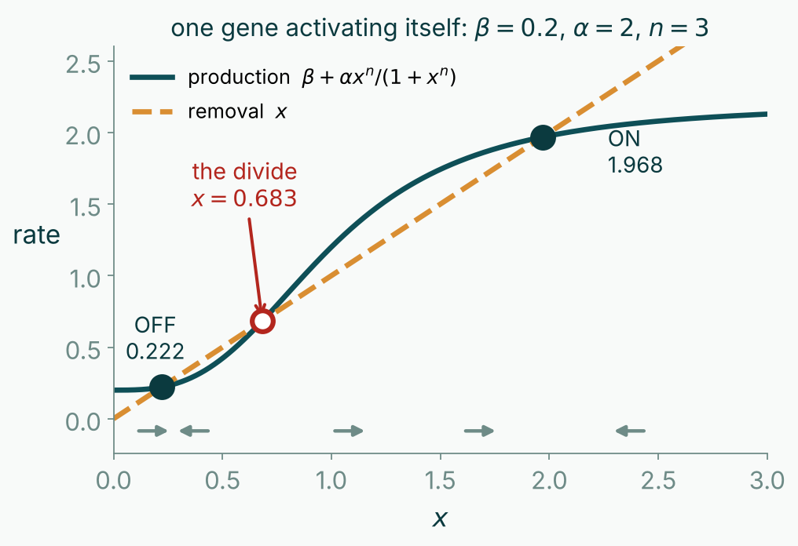
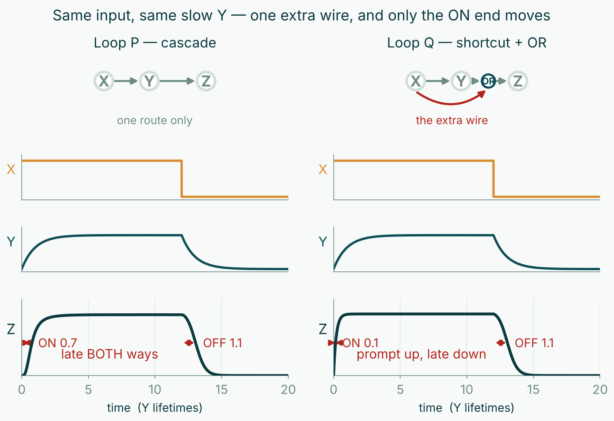

<!--
title: Session 14 — Five motions: answers
subtitle: All five items, worked. Posted after class.
session: 14
-->

# Answers — all five items

The prose under each **▶** is the part worth reading. On every one of these the
reasoning is the answer; the verdict on its own earns half, which is exactly the
rule the midterm uses.

## 1 — Follow a disturbance around a loop

**The loop:** four genes, mixed signs — $X \dashv Y$, $Y \longrightarrow Z$,
$Z \dashv W$, $W \dashv X$.

**Walk it.** Nudge $X$ **up**. $Y$ goes **down**. $Y$ *activates* $Z$, so $Z$ goes
**down** — no flip at that step. $Z$ represses $W$, so $W$ goes **up**. $W$ represses
$X$, so $X$ is pushed **down**.

**What comes back: $X$ down — reversed.** Count the **bars**, not the edges: three of
the four arms invert, and three is odd, so the disturbance returns **flipped**.

**▶ Can it be a clock?** It passes the **flipped** half, so yes — *provided* it also
returns **unshrunk**, which is a separate question about the gain of each step, and
provided the trip takes long enough that the correction arrives after the disturbance
has already grown rather than cancelling it on the spot. Flipped and unshrunk is
**necessary, not sufficient**.

**▶ Why the number of flips and not their strength.** Strength decides whether the
disturbance comes back **shrunk**. It cannot change the *sign* that returns. So no
amount of gain rescues an **even** loop — you would be making a latch more decisive,
not turning it into a clock — and no amount of gain is *enough* on its own for an odd
one either.

**▶ Change exactly one edge.** With $Z \longrightarrow W$ instead of $Z \dashv W$ the
walk is: $X$ up, $Y$ down, $Z$ down, $W$ **down**, and $W$ represses $X$, so $X$ comes
back **up** — unflipped. **Two bars, even: it latches.** Nothing about the strengths
changed, nothing about the number of genes changed, and the verdict reversed. That is
the point of the pair: parity is the whole of the first question.

**The worked loop** ($X \dashv Y \dashv Z \longrightarrow X$): two flips, even, so it
latches as well.

## 2 — Read the signs of a Jacobian off the wiring

**The circuit:** a three-gene cascade. $X$ is made at a constant rate; $X$ activates
$Y$; $Y$ represses $Z$; nothing feeds back.

$$J = \begin{pmatrix} - & 0 & 0 \\ + & - & 0 \\ 0 & - & - \end{pmatrix}$$

**▶ Where each entry comes from.**

- **The three diagonal entries are all $-1$**, each from that species' own removal.
  None of the three acts on itself, so no production term contributes. *This is the
  entry people get wrong* — they go looking for a production term and there is none.
- $\partial\dot{y}/\partial x$: **positive** — $X$ activates $Y$.
- $\partial\dot{z}/\partial y$: **negative** — $Y$ represses $Z$.
- **Four entries are exactly ZERO**, and this is the part worth the item:
  $\partial\dot{x}/\partial y$, $\partial\dot{x}/\partial z$,
  $\partial\dot{y}/\partial z$ and $\partial\dot{z}/\partial x$. A zero does not
  mean "small" — it means the wiring has no arrow there at all, so that species
  appears nowhere in the other's equation. $X$'s production is a constant $\beta_x$;
  nothing downstream can reach back and change it.

**▶ Why does that step follow — what "triangular" buys you.** Every entry above the
diagonal is zero, so the matrix is **lower triangular**, and the eigenvalues of a
triangular matrix are exactly **its diagonal entries**. Here that is $-1, -1, -1$:
all real, all negative, at **every** parameter value.

So without computing anything you can say two things about this circuit. It cannot
be unstable — no choice of $\beta$, $\alpha$ or $n$ makes an eigenvalue positive.
And it cannot oscillate on its own: there is no imaginary part to oscillate with.

**The reason behind the algebra is the wiring, not the matrix.** The zeros above the
diagonal are precisely the statement that **nothing feeds back**. Influence runs one
way down the chain, so a disturbance that reaches $Z$ has nowhere to go — it cannot
return to $X$ and be amplified. A circuit with no loop in it has no round trip to
pass or fail, which is the same sentence item 1 was making from the other side.

## 3 — Draw a time course

**▶ The two curves.** Both start at **zero** — that one is shared, because there is
no protein yet either way.

They part immediately. At early times there is almost no protein, so there is almost
nothing repressing the autoregulated gene: it leaves at **the same initial slope** as
the unregulated one, $\beta$. As protein accumulates it starts repressing itself, the
climb bends over sooner, and it settles at a **lower** final level.

**▶ The half-way times.** Mark each curve's own. The autoregulated curve reaches
**half of its own, lower, final level sooner** — it has less distance to cover and
the same departure rate.

**▶ Which of the three things changed.** The **end** certainly did: adding repression
to an unchanged promoter must lower the steady level. The **start** did not. The
**initial slope** is the interesting one — it is essentially unchanged, because at
$t=0$ there is no repressor present to act.

**▶ So what does "faster" mean here?** That is the question to be careful about, and
it is worth being able to state the comparison you are making before you answer it.
Two curves that end in different places can be compared in more than one way, and
the ways do not agree. Have the comparison straight in your head before Thursday.

## 4 — Say which state a circuit ends up in

**The circuit:** one gene activating its own promoter,
$\dot{x} = 0.2 + 2x^{3}/(1+x^{3}) - x$.

**▶ (a) and (b) — the sketch and what it tells you.** Production is a sigmoid that
starts at $\beta = 0.2$ and saturates at $\beta + \alpha = 2.2$; removal is the
straight line $x$. They cross three times — at $x = 0.222$, $x = 0.683$ and
$x = 1.968$.

The reading takes no calculus at all. **Where production is above removal, $x$ grows;
where it is below, $x$ shrinks.** Put arrows on the $x$-axis accordingly and the
answer falls out:

- below $0.222$ production wins, so $x$ climbs **to** $0.222$;
- between $0.222$ and $0.683$ removal wins, so $x$ falls **back to** $0.222$;
- between $0.683$ and $1.968$ production wins again, so $x$ climbs **to** $1.968$;
- above $1.968$ removal wins, so $x$ falls **back to** $1.968$.

Arrows point *toward* $0.222$ and $1.968$ from both sides — those are the two
**states**. Arrows point *away* from $0.683$ on both sides — that is the **divide**.

**▶ (c) The number.** The pulse has to leave $x$ **above $0.683$**. At $0.68$ the cell
slides back to the off state; at $0.69$ it climbs to the on state and stays there.

**▶ Why does that step follow — one variable versus two.** With one variable the
state lives on a **line**, and a divide on a line can only be a **point**: there is
one way past it, so "how far along $x$" and "which side" are the same question.

Add a second variable and the state lives in a **plane**. The divide becomes a
**curve**, and the two questions come apart — which is exactly what the slides' mutual
activator showed. Its unstable point sits at $x = y = 0.382$, but a pulse that raises
$X$ alone leaves the cell on the $x$-axis, where the curve is a long way out at
$x = 0.711$. A pulse to $0.5$ is well past $0.382$ and still falls back off. **Which
side of the curve, not how far along one axis.**

*(Every number here was computed, not estimated: the three crossings by root-finding
on the rate balance, and the $0.711$ by integrating the two-gene circuit forward from
$(x,\,0)$ and finding where the outcome flips.)*

## 5 — Read a trace off the wiring and the timing

**(a) Which end the shortcut changes.** It changes the **switching-on** end and
leaves the switching-off end alone. Loop P reaches half its final level **0.7**
lifetimes after $X$ arrives; Loop Q gets there in **0.1**. Coming down, both take
about **1.1** lifetimes. (Computed from the model, not read off a sketch.)

**(b) Why — in terms of what $Z$ is waiting for.** With an **OR** gate, $Z$ turns on
if *either* input is present. On the way up $X$ is present immediately, so $Z$ does
not wait for $Y$ at all. On the way down $X$ disappears, but $Y$ is still high and
still satisfies the OR on its own — so $Z$ cannot fall until $Y$ has decayed, and $Y$
is the slow one. The shortcut buys you speed at the end where it is the *only* thing
needed, and buys nothing at the end where the slow arm is still holding the gate open.

**(c) If the gate were AND.** The delay moves to the **other end**. AND needs *both*
inputs, so on the way up $Z$ waits for $Y$ to arrive — delayed on. On the way down,
losing $X$ alone breaks the AND immediately, so $Z$ falls at once — prompt off.

**This is the whole idea, and it is why "coherent loops delay the ON step" is not a
rule worth memorising.** The same wiring gives opposite answers under the two gates.
Work out what the output is waiting for at each end and the answer follows; recall a
slogan and you have a one-in-two chance.

**The cascade, for contrast,** is late at *both* ends by about the same amount,
because $Y$ stands between $X$ and $Z$ in both directions. A symmetric delay means no
shortcut exists.

## The five sentences

1. **Count the flips before you reason about strength.** An even number of inversions
   cannot be rescued by any amount of gain.
2. **The signs of a Jacobian come from the wiring.** Own removal on the diagonal; who
   acts on whom off it. Nothing is differentiated — and a zero is not a small number,
   it is a missing arrow.
3. **A curve is a start, a slope and an end.** Feedback changes exactly one of them.
4. **Which side, not how far.** Where a disturbance leaves you decides where you end
   up. With one variable the divide is a number; with two it is a curve, and reading
   a curve as a number on one axis is how the question is usually got wrong.
5. **A shortcut changes one end only, and the gate decides which.** Ask what the
   output is waiting for at each end.
