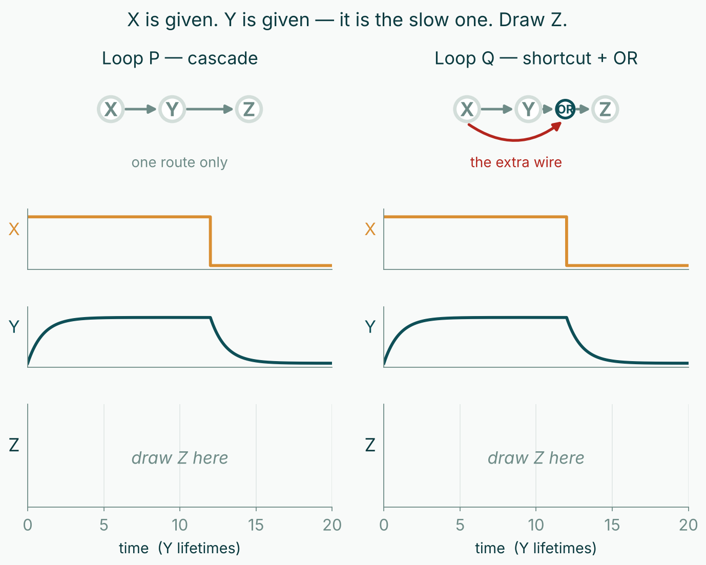

<!--
title: Session 14 — Five motions, in the shape they will be asked
subtitle: Not a practice exam. Five things this course asked you to watch rather than do, each worked once and then handed to you.
session: 14
-->

# Five motions, in the shape they will be asked

There is nothing new here. These are five moves you have seen done — on a slide,
on the board, in a worked answer — and have not often done yourself with a pencil.
Each one is worked once below, then handed to you on a different circuit.

**None of these circuits is on Thursday's paper.** The point is the motion, not the
example.

Write in the boxes. The box is a guide to how long the answer should be.

---

## 1 — Follow a disturbance around a loop

A loop is a clock only if a disturbance comes back **flipped** and **not shrunk**.
Nudge one gene up and walk it round: each step either flips the sign or keeps it,
and each step shrinks or amplifies. Come back unflipped and the disturbance
reinforces what started it — the circuit latches into a state. Come back shrunk and
it dies — the circuit settles.

**Worked.** Three genes, mixed signs: $X \dashv Y$, $Y \dashv Z$, $Z \longrightarrow X$.
Nudge $X$ up. $Y$ goes down. $Z$ goes up. $Z$ **activates** $X$, so $X$ goes up —
**unflipped**. Two flips, an even number, so the disturbance reinforces what began
it. This loop cannot be a clock at any gain; it latches.

**▶ Now you.** A **four-gene loop with mixed signs**:

$$X \dashv Y, \qquad Y \longrightarrow Z, \qquad Z \dashv W, \qquad W \dashv X$$

Walk a nudge in $X$ once around and say what comes back.

**Can this loop be a clock?** If not, say which half of the test it fails and what
it does instead. If it can, say what still has to be true.

*Why does that step follow?* — what is it about the **number** of sign flips, rather
than their strength, that settles this?

**▶ And one more — change exactly one edge.** In the same four-gene loop, replace
$Z \dashv W$ with $Z \longrightarrow W$ and leave everything else alone. Clock or
not? Say what changed and what did not.

---

## 2 — Read the signs of a Jacobian off the wiring

You have computed eigenvalues from numbers all term. This is the other direction:
what the **pattern of signs** is, and where each sign comes from — no
differentiation.

The rule is short. For $\dot{x}_i = (\text{production}) - x_i$:

- The **diagonal** $\partial\dot{x}_i/\partial x_i$ carries that species' own
  removal, so it is **negative** — unless the species also acts on itself.
- An **off-diagonal** $\partial\dot{x}_i/\partial x_j$ carries only how $j$ changes
  $i$'s production. If $j$ **represses** $i$, raising $j$ lowers the production, so
  the entry is **negative**. If $j$ **activates** $i$, the entry is **positive**.

**Worked.** An **activator–repressor** pair: $X$ activates $Y$, $Y$ represses $X$,
$\dot{x} = \alpha/(1+y^{\,n}) - x$ and $\dot{y} = \beta x^{\,n}/(1+x^{\,n}) - y$:

$$J = \begin{pmatrix} - & - \\ + & - \end{pmatrix}$$

Both diagonals negative — each protein is removed, and neither acts on itself.
Top-right negative: $Y$ represses $X$, so raising $y$ lowers $X$'s production.
Bottom-left **positive**: $X$ activates $Y$.

**▶ Now you.** A **three-gene cascade**: $X$ activates $Y$, $Y$ represses $Z$, and
nothing feeds back.

$$\dot{x} = \beta_x - x, \qquad
\dot{y} = \frac{\beta\,x^{\,n}}{1+x^{\,n}} - y, \qquad
\dot{z} = \frac{\alpha}{1+y^{\,n}} - z$$

Fill in the **nine** signs, and say where each comes from. Several are **zero** —
say why, because that is the part that is new.

$$J = \begin{pmatrix}
\underline{\phantom{00}} & \underline{\phantom{00}} & \underline{\phantom{00}} \\[2pt]
\underline{\phantom{00}} & \underline{\phantom{00}} & \underline{\phantom{00}} \\[2pt]
\underline{\phantom{00}} & \underline{\phantom{00}} & \underline{\phantom{00}}
\end{pmatrix}$$

*Why does that step follow?* — a cascade's Jacobian is **triangular**. Say in one
line what that tells you about its eigenvalues without computing any of them.

---

## 3 — Draw a time course

You have watched these on the screen. Drawing one is a different skill, and it is
quicker than it looks: what matters is the **shape** and the **relative timing**, not
numbers.

Three things make a curve: where it starts, how fast it leaves, and where it ends.
Get those three right and the curve between them is just a smooth line.

**Worked.** A gene switched on at $t = 0$ with constant production and first-order
removal starts at zero, rises fastest at the start, and flattens onto
$\beta/\gamma$. Its half-way time is $\ln 2/\gamma$ — one half-life — and it is
**within about 6% of its final level after four half-lives**.

**▶ Now you.** On the axes below, draw **two** curves for a gene switched on at
$t = 0$:

- **(a)** an unregulated gene, rising to its steady level;
- **(b)** the **same gene with negative autoregulation added** and nothing else
  touched — same promoter, same removal rate.

Label which is which, and mark each curve's **half-way time** on the time axis.

<svg viewBox="0 0 600 300" style="width:100%;max-width:5.6in;height:auto;display:block;margin:0.1in auto">
  <line x1="55" y1="266" x2="565" y2="266" stroke="#5A7D78" stroke-width="1.6"/>
  <line x1="55" y1="266" x2="55" y2="22" stroke="#5A7D78" stroke-width="1.6"/>
  <text x="12" y="150" font-size="13" fill="#2F4F4F" transform="rotate(-90 22,150)">output</text>
  <text x="300" y="294" font-size="13" fill="#2F4F4F" text-anchor="middle">time  (protein lifetimes)</text>
  <g stroke="#A8C8D8" stroke-width="1">
    <line x1="157" y1="263" x2="157" y2="269"/><line x1="259" y1="263" x2="259" y2="269"/>
    <line x1="361" y1="263" x2="361" y2="269"/><line x1="463" y1="263" x2="463" y2="269"/>
    <line x1="565" y1="263" x2="565" y2="269"/>
  </g>
  <g font-size="11" fill="#6E8B87" text-anchor="middle">
    <text x="55" y="282">0</text><text x="157" y="282">1</text><text x="259" y="282">2</text>
    <text x="361" y="282">3</text><text x="463" y="282">4</text><text x="565" y="282">5</text>
  </g>
</svg>

*Why does that step follow?* — of the three things that make a curve (start, initial
slope, end), say which ones the feedback changed and which it left alone. There is
more than one.

---

## 4 — Say which state a circuit ends up in

A circuit with two stable states has a **divide** between them, and it always runs
*into* an unstable point. Start on one side of it and the flow carries you to one
state; start on the other and you reach the other. Nothing else decides it — not how
large a disturbance was, only **which side it left you on**. With one variable the
divide is a single **number** on the $x$-axis; with two it is a **curve** in the
plane, and that difference is the whole of this item.

**Worked — in class.** Two genes that **activate each other**, $\alpha = 3$, $n = 2$.
Its two states are *both off* and *both on*, with an unstable point between them at
$x = y = 0.382$. A pulse raises $X$ **alone**, so the cell is left somewhere on the
$x$-axis with $Y$ still at zero — and the dividing line crosses that axis at
$x = 0.711$, nowhere near $0.382$. A pulse to $x = 0.5$ is well past the middle point
and **still falls back off**. The rule is *which side of the curve*, never *how far
along one axis*.

**▶ Now you — a circuit with only one variable.** A single gene **activates its own
promoter**, with a small constant basal rate and the usual first-order removal:

$$\dot{x} \;=\; \beta \;+\; \frac{\alpha\,x^{\,n}}{1+x^{\,n}} \;-\; x,
\qquad \beta = 0.2, \quad \alpha = 2, \quad n = 3$$

**(a)** Sketch the **production** term and the **removal** term on the same axes
against $x$, and mark every point where they cross.

<svg viewBox="0 0 600 300" style="width:100%;max-width:5.4in;height:auto;display:block;margin:0.1in auto">
  <line x1="55" y1="262" x2="565" y2="262" stroke="#5A7D78" stroke-width="1.6"/>
  <line x1="55" y1="262" x2="55" y2="20" stroke="#5A7D78" stroke-width="1.6"/>
  <text x="14" y="150" font-size="13" fill="#2F4F4F" transform="rotate(-90 22,150)">rate</text>
  <text x="310" y="292" font-size="13" fill="#2F4F4F" text-anchor="middle">x</text>
  <g stroke="#A8C8D8" stroke-width="1">
    <line x1="52" y1="182" x2="58" y2="182"/><line x1="52" y1="102" x2="58" y2="102"/>
    <line x1="52" y1="22" x2="58" y2="22"/>
  </g>
  <g font-size="11" fill="#6E8B87" text-anchor="end">
    <text x="47" y="266">0</text><text x="47" y="186">1</text>
    <text x="47" y="106">2</text><text x="47" y="26">3</text>
  </g>
  <g stroke="#A8C8D8" stroke-width="1">
    <line x1="140" y1="259" x2="140" y2="265"/><line x1="225" y1="259" x2="225" y2="265"/>
    <line x1="310" y1="259" x2="310" y2="265"/><line x1="395" y1="259" x2="395" y2="265"/>
    <line x1="480" y1="259" x2="480" y2="265"/><line x1="565" y1="259" x2="565" y2="265"/>
  </g>
  <g font-size="11" fill="#6E8B87" text-anchor="middle">
    <text x="55" y="278">0</text><text x="140" y="278">0.5</text><text x="225" y="278">1.0</text>
    <text x="310" y="278">1.5</text><text x="395" y="278">2.0</text><text x="480" y="278">2.5</text>
    <text x="565" y="278">3.0</text>
  </g>
</svg>

**(b)** There are three crossings. Which are the **states**, which is the **divide**,
and how does your sketch tell you — without computing a single derivative?

**(c)** The cell sits at the lower state. Give the **number** a brief pulse has to
push $x$ past for the cell to switch on and stay on.

*Why does that step follow?* — here the divide is a **number**; in the two-gene case
on the slides it was a **curve**, and reading it as a number on one axis gave the
wrong answer. Say in one line what it is about having two variables that makes the
difference.

---

## 5 — Read a trace off the wiring and the timing

Two circuits take the same input $X$, which turns **on** at $t=0$ and **off** twelve
lifetimes later. In both, $Z$ follows its own promoter quickly; the intermediate $Y$
is the slow one and sets the clock.

**Loop P — a cascade.** $X \longrightarrow Y \longrightarrow Z$. Nothing else.

**Loop Q — a shortcut and an OR gate.** $X \longrightarrow Y \longrightarrow Z$ **and**
$X \longrightarrow Z$, with $Z$ switched on by **either** input — $X$ **OR** $Y$.

**Worked, for Loop P.** When $X$ arrives, $Z$ cannot move until $Y$ has built up,
and $Y$ is slow — so the rise is **late**. When $X$ leaves, $Z$ cannot fall until $Y$
has decayed away, and $Y$ is still slow — so the fall is **late too**. A cascade is
late at **both** ends, by roughly the same amount. The delay is symmetric.

**▶ Now you.** Each column below carries its own wiring, its input $X$, and its
slow arm $Y$. Only the $Z$ panels are empty. Draw Loop P's $Z$ in the left column
(you have just been told its shape), then **Loop Q's** in the right.

Then answer, in one line each:

**(a)** Which end — switching on, or switching off — does the shortcut change, and
which does it leave alone?

**(b)** Why does the OR gate do that? Say it in terms of what $Z$ is waiting for at
each end.

**(c)** A circuit whose delay is different in the two directions is called
**sign-sensitive**. If the gate were **AND** instead of OR, which end would be
delayed? Do not guess — reason it from what each gate needs.

---

## If you only take one thing from each

1. **Count the flips before you reason about strength.** An even number of
   inversions cannot be rescued by any amount of gain.
2. **The signs of a Jacobian come from the wiring**, not from differentiating. Own
   removal on the diagonal; who acts on whom, and in which direction, off it.
3. **A curve is a start, a slope and an end.** Draw those and join them.
4. **Which side, not how far.** A circuit with two states has a line between them,
   and where a disturbance *leaves* you decides where you end up.
5. **A shortcut changes one end, not both.** Which end depends on the gate — work it
   out from what the output is waiting for, never from a remembered rule.
